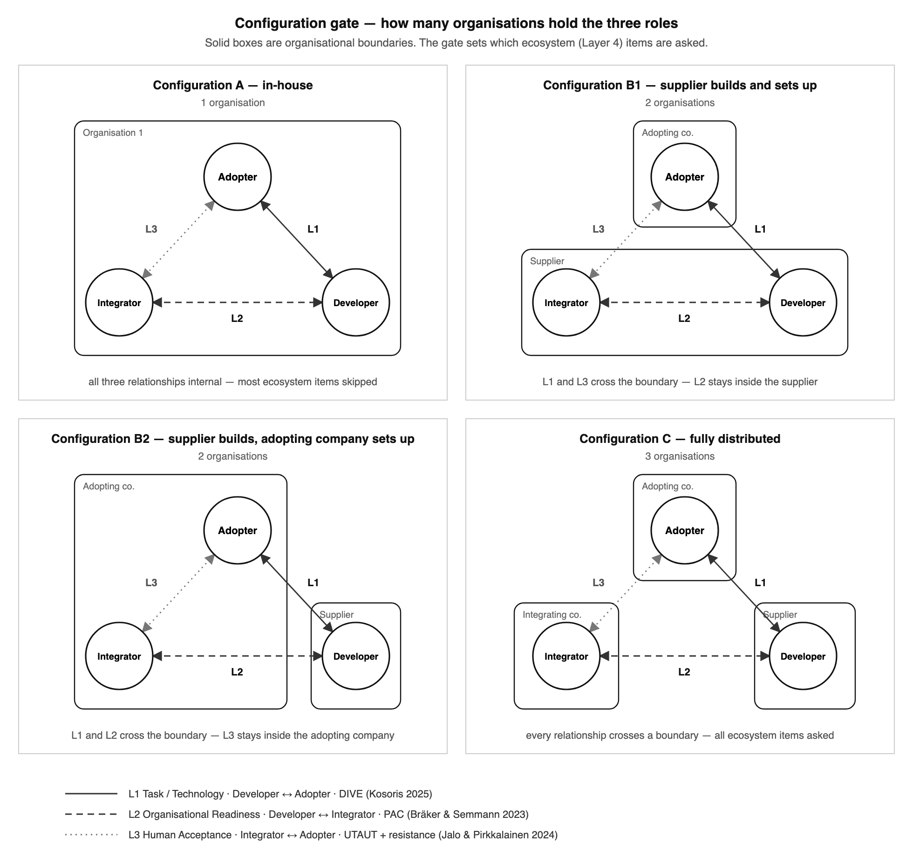
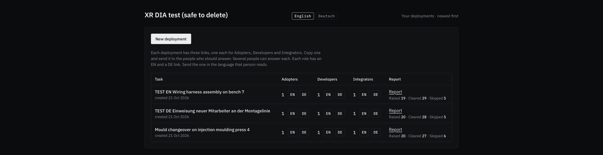
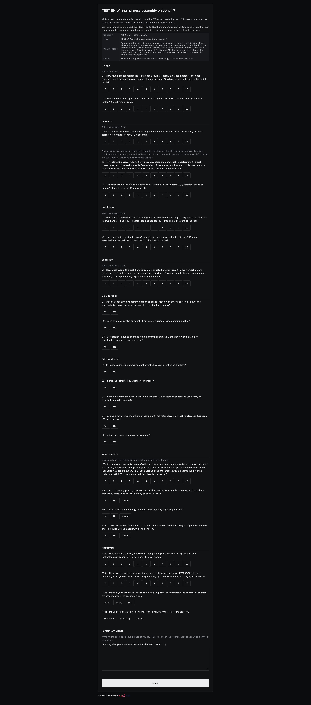
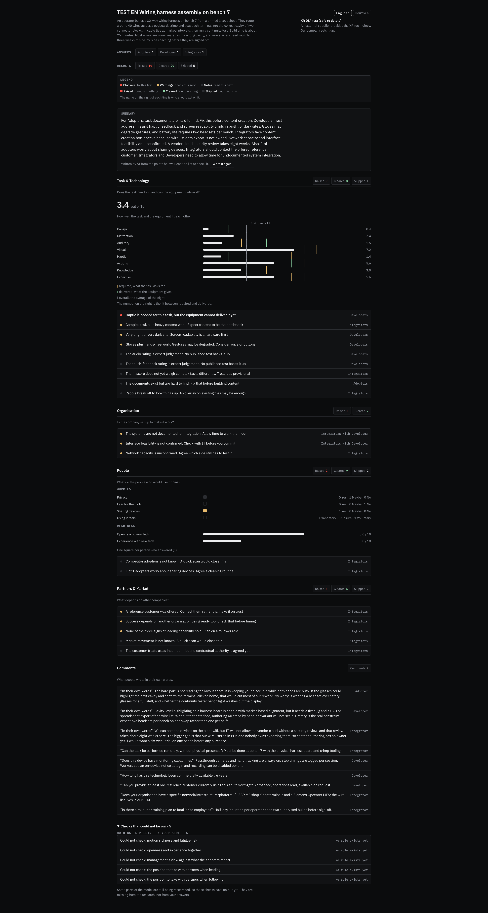

# Extended reality adoption assessment tool

A staged diagnostic pipeline that helps an industrial organisation decide whether and how to adopt
extended reality for one task. Three roles answer their own questionnaire, four layers of rules run
in parallel, and a report names what to look at and who should act on it. English and German.

Built for the research paper *A Staged Diagnostic Pipeline for Pre-Deployment XR Adoption Decisions
in Industry*.

## What it looks like

The four configurations the gate can record. Which roles sit in which organisation decides what
Layer 4 asks, and which relationships have to be verified rather than taken on trust.



The company page. One row per deployment, one link per role, and the report when the answers are in.



The adopter questionnaire. Each role is asked only what it can answer for itself.



The report. A plain summary, the fit score against what the equipment delivers, then the findings
per layer, each with the role that should act on it.



The screenshots come from a test deployment with invented answers, not from a real company.

## Documentation

| | |
| --- | --- |
| [The model](documentation/model.md) | The three roles, the four layers, the configuration gate, the fit score |
| [Questions](documentation/questions.md) | All 87 questions, as the forms ask them |
| [Rules](documentation/rules.md) | All 53 rules, their inputs and what the report shows |
| [Architecture](documentation/architecture.md) | How the code becomes n8n workflows, and how it is tested |

## Running it

Needs Node.js 20 or newer and an [n8n](https://n8n.io) instance, version 2.2.5 or compatible.

```bash
npm test                       # runs without n8n and without the evaluation data
```

To build and deploy, copy each example file and fill it in:

```bash
cp .env.example .env                                                   # an n8n API key
cp configuration/instance.example.json configuration/instance.json     # the n8n host URL
cp configuration/tables.example.json configuration/tables.json         # five Data Table IDs
cp configuration/credentials.example.json configuration/credentials.json
cp data/evaluation-devices.example.csv data/evaluation-devices.csv
cp data/evaluation-platforms.example.csv data/evaluation-platforms.csv
npm run build                  # writes workflows/
npm run deploy                 # creates or updates them in n8n
```

In n8n, create three credentials and five Data Tables first, then put their IDs in
`configuration/`. `npm run deploy` refuses to run while an ID is missing.

| Credential | Used for |
| --- | --- |
| HTTP Basic Auth | the team page |
| OpenRouter | the report summary, fallback models |
| Google Gemini | the report summary, first models |

| Data Table | Columns |
| --- | --- |
| organisations | organisationSlug, organisationName, accessKey, createdAt |
| deployments | deploymentId, organisationSlug, organisationName, taskName, taskDescription, technology, rollout, createdAt |
| submissions | deploymentId, formName, respondentName, submissionAnswers, createdAt |
| evaluation devices | device, characteristic, criterion, score |
| evaluation platforms | thesisTable, platform, confidenceTier, characteristic, score |

`npm run verify` checks every question against the research workbook and takes its path as an
argument. That workbook is not published here.

## Layout

```
source/           all logic: questions, rules, scoring, pages. Pasted into n8n Code nodes
scripts/          build, deploy, and the check that proves questions against the workbook
tests/            the test suite, run against the same text that ships
documentation/    the model, the questions, the rules, the architecture
configuration/    table and credential IDs of your own instance
data/             hardware and software evaluation scores (examples only)
prompts/          the system prompt for the report summary
styles/           CSS for the forms and the pages
```

## Licence

Code: [MIT](LICENSE).

The assessment questions and rules come from the research instrument of the paper above. They are
included so the tool can be read and reproduced, and they remain with their authors.
